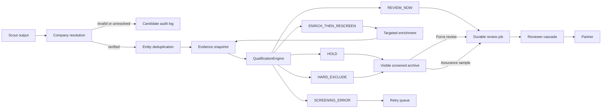

# Review Admission Control — Evidence-Backed Qualification

**Date:** 2026-07-11
**Status:** Approved design direction; pending written-spec review
**Scope:** Scout → Reviewer admission, screened-company visibility, force review,
assurance sampling, and the staged path to adaptive review
**Initial implementation boundary:** Releases 0–2 in this document

## Executive decision

Aethria will introduce an explicit, user-scoped qualification stage between Scout
and Reviewer:

```text
Scout → Resolve and deduplicate → Qualify → Reviewer → Partner → Portfolio
```

Qualification is not a top-N selector and does not target a fixed review rate.
Its operating objective is:

> Maximize reviewer workload saved, subject to a bounded, continuously audited
> false-negative risk and complete analyst override.

The system will distinguish four substantive qualification outcomes:

- `REVIEW_NOW`
- `ENRICH_THEN_RESCREEN`
- `HOLD`
- `HARD_EXCLUDE`

`SCREENING_ERROR` is a technical state, never a negative investment judgment.
Every outcome is evidence-backed, versioned, reversible, and reconstructable.

The first implementation will establish the decision contract, run qualification
in shadow mode, and add a durable force-review path. It will activate only
deterministic hard exclusions. Evidence-based holds, value-of-information
enrichment, adaptive reviewers, and learned calibration ship only after the
earlier releases produce sufficient assurance data.

## Product promise

Aethria must not promise that it never misses a great company or that analysts
never need to question it. The defensible promise is:

> Aethria allocates review attention through evidence-backed, versioned, and
> reversible qualification decisions, continuously audited for companies it may
> have missed.

The analyst can always see what happened, why it happened, which evidence was
used, what remains unknown, what would change the result, and how to force a
review.

## Problem

The current ReviewerEngine loads rows whose `review_info` is null, sorts them by
the Scout's self-reported confidence, and skips rows below a configurable
confidence threshold. This produces several problems:

- Low-confidence rows remain indefinitely “unreviewed” rather than receiving an
  explicit disposition.
- Scout confidence is not a calibrated probability of review value.
- There is no durable explanation, policy version, or re-screen trigger.
- The system cannot estimate false negatives because skipped companies receive
  no downstream labels.
- Periodic cycles repeatedly inspect skipped rows.
- On-demand lookups already bypass the confidence threshold, but there is no
  equivalent durable, analyst-controlled override for ordinary discoveries.
- Concurrent periodic and lookup workers can both begin expensive review work
  before either has written `review_info`.

The feature must solve those problems without weakening tenant isolation,
reference validation, cost budgets, fund-thesis gating, or row-level Supabase
storage.

## Explicitly out of scope

- Settings-page restructuring or new qualification controls in Settings.
- A fixed “review 30 out of 100” quota.
- A startup-success probability.
- Automatic rejection from missing evidence.
- Learned admission in the first implementation.
- Cross-fund or cross-user training.
- Founder personality, demographic, prestige, or social-popularity scoring.
- Automatic MetaAgent changes to active qualification policy.
- Multi-provider reviewer ensembles.
- Replacing Partner's versioned rule engine.

## Design principles

1. **Eligibility is not priority.** Hard fund constraints determine eligibility;
   prioritization determines timing.
2. **Potential is not observability.** Missing public evidence lowers confidence
   and may trigger enrichment; it does not lower intrinsic company potential.
3. **Unknown is not negative.** Unknown, conflicting, or stale values cannot
   satisfy a hard negative rule.
4. **Only explicit constraints block.** Existing preferred stages, geographies,
   and sectors remain preferences. Only exclusions explicitly represented as hard
   constraints may produce `HARD_EXCLUDE`.
5. **No quota.** All companies that satisfy `REVIEW_NOW` remain eligible for
   review. Capacity controls pace, never admission.
6. **False negatives dominate.** A missed fund-returning company is more costly
   than several unnecessary reviews, so the gate is recall-oriented.
7. **Abstention is a valid result.** The system enriches or holds when evidence is
   insufficient instead of forcing a binary answer.
8. **Explanations reflect execution.** User-facing explanations are rendered from
   the deterministic decision trace, not generated afterward as persuasive prose.
9. **Every expensive stage is claimed.** Durable database leases prevent duplicate
   work and stale overwrites.
10. **Every change is a release.** Thesis, policy, prompts, weights, models, and
    routing are versioned together.

## Funnel definitions

“Sourced” is not a sufficient denominator. Aethria will report:

1. Scout attempts
2. Schema-valid Scout outputs
3. Unique resolved companies
4. Duplicate discoveries merged
5. Qualification outcomes
6. Production reviews queued and completed
7. Assurance reviews queued and completed
8. Discovery reviews queued and completed
9. Analyst-forced reviews queued and completed

Review coverage is calculated over unique resolved companies. Invalid or
unresolved Scout attempts remain in a minimal candidate audit log but do not enter
the `startups` table or the qualification denominator. This preserves mandatory
reference validation while making discovery quality measurable.

## Architecture



### Component boundaries

#### `QualificationEngine`

Pure, deterministic policy evaluation for a supplied company snapshot. It accepts:

- `user_id`
- resolved startup/scout data
- evidence snapshot
- active fund-thesis context and version
- qualification-policy version
- decision-system release ID
- evaluation trigger

It returns a validated `ScreeningInfo` and has no storage or network side effects.
Qualification rules live in versioned JSON under
`resources/config/qualification_policies/` and are resolved through the existing
policy-resolver pattern. Thresholds and hard constraints are not hardcoded in the
engine.

#### `QualificationService`

Coordinates storage, policy loading, evidence snapshotting, job creation, and
current-state projection. It calls `require_user_id()` at construction and on
public entrypoints.

#### Evidence service

Builds claim-level provenance and independent evidence families. Releases 0–2
persist a minimal evidence snapshot from existing Scout references. Release 3
adds generalized claim verification, contradiction detection, source roles, and
targeted enrichment.

#### Stage-job service

Atomically claims expensive work, renews leases, records attempts, and prevents a
result computed from stale inputs from becoming current.

#### Assurance service

Selects probability samples from `HOLD`, saves inclusion probabilities, and
produces version-specific miss-risk estimates with confidence intervals.

## Qualification method

### Step 1: Company resolution and deduplication

Qualification only runs for a verified, unique company entity. Multiple Scout
personas discovering the same company merge into one entity while preserving all
discovery provenance.

Entity resolution must replace substring-only incumbent and name matching over
time. A name collision or ambiguous domain produces an unresolved candidate, not
an investment exclusion.

### Step 2: Explicit hard constraints

Initial active hard rules are limited to facts that are both verified and
explicitly mandatory in the active thesis policy, such as:

- an explicitly excluded sector or company type;
- an explicitly mandatory stage, only when the thesis representation marks it as
  mandatory rather than preferred;
- an explicitly mandatory geography, under the same condition.

Current `preferredStages`, `geographies`, and `sectors` are preferences. They must
not silently become hard exclusions. Unknown or disputed values cannot trigger a
hard rule.

### Step 3: Evidence assessment

The system maintains separate factor assessments rather than presenting a single
probability:

- thesis fit;
- evidence reliability;
- evidence completeness;
- source independence;
- Scout confidence;
- problem and why-now signals;
- contradictions;
- uncertainty.

Releases 0–2 may compute an internal shadow priority index for comparison, but it
is never displayed as a probability and cannot drive active non-hard holds.

### Step 4: Potential versus observability

Every material factor records both its current potential assessment and evidence
confidence. Examples:

```text
Potential: promising technical wedge
Observability: low — only a company-authored source is available
Action: ENRICH_THEN_RESCREEN
```

Missing traction for a pre-seed company is not equivalent to missing traction for
a Series A company. Applicability and evidence expectations are stage- and
sector-aware.

### Step 5: Value-of-information enrichment

Release 3 routes a missing fact to enrichment when it is material enough to
change admission and affordable to acquire. The decision trace records:

- missing or disputed claim;
- why it is material;
- permitted source types;
- acquisition cost class;
- outcome if verified, contradicted, or unresolved.

Enrichment failure returns `HOLD` with an explicit knowledge limit; it never
reduces company potential automatically.

### Step 6: Outcome

`REVIEW_NOW` means the company warrants full review. `HOLD` means current evidence
does not justify review cost but the company remains visible and reversible.
`HARD_EXCLUDE` means a verified fact violates an explicit mandatory constraint.
`SCREENING_ERROR` means the system failed to evaluate and must retry.

## Data contracts

All shapes live in backend Pydantic models and use `.model_dump()` /
`.model_validate()`.

### Core enums

```python
QualificationOutcome = Literal[
    "REVIEW_NOW",
    "ENRICH_THEN_RESCREEN",
    "HOLD",
    "HARD_EXCLUDE",
    "SCREENING_ERROR",
]

QualificationTrigger = Literal[
    "PERIODIC_PIPELINE",
    "THESIS_CHANGE",
    "POLICY_CHANGE",
    "EVIDENCE_CHANGE",
    "ASSURANCE_SAMPLE",
    "ANALYST_FORCE_REVIEW",
    "ON_DEMAND_LOOKUP",
]
```

### `FactorAssessment`

Contains factor name, applicability, normalized value, evidence confidence,
supporting claim IDs, contradiction IDs, and policy rule IDs. It does not contain
free-form LLM rationale as the source of truth.

### `ScreeningInfo`

Contains:

- recommended outcome, effective action, and queue state;
- `SHADOW` or `ACTIVE` enforcement mode;
- whether the recommendation was enforced;
- reason codes and concise rendered summary;
- factor assessments;
- hard-rule trace;
- missing and conflicting claim IDs;
- executable counterfactual conditions;
- evidence snapshot hash;
- thesis, policy, and release versions;
- trigger;
- evaluation and expiry timestamps;
- override metadata when applicable.

In `SHADOW` mode, `recommended_outcome` records what the candidate policy would
have done, `effective_action` records the unchanged legacy pipeline action, and
`enforced` is false. The UI and metrics must never present a shadow recommendation
as an applied hold. In `ACTIVE` mode, `effective_action` is derived from the
recommended outcome plus any assurance, on-demand, or analyst override trigger.

### `EvidenceClaim`

Release 3 shape:

- subject and field;
- value and as-of date;
- support status;
- source role;
- supporting excerpt and URL;
- evidence-family ID;
- retrieved and verified timestamps;
- supports, contradicts, or mentions relationship;
- confidence and freshness state.

Personal-data fields carry purpose and retention classifications. Sensitive
personal characteristics are prohibited from qualification input.

## Supabase schema

All tables include `user_id`, use service-role writes, and receive tenant RLS
policies consistent with existing startup tables. New migrations are additive and
timestamped; existing migrations are never modified.

### `startup_qualification_decisions`

Append-only decision history:

- IDs for user, startup, thesis version, policy version, and release;
- outcome, reason codes, full validated decision JSON;
- evidence snapshot hash;
- trigger;
- created timestamp.

A unique idempotency constraint covers user, startup, trigger, and complete input
fingerprint.

### `startup_stage_jobs`

Durable work claims:

- user, startup, stage, and input fingerprint;
- trigger and priority class;
- `pending`, `claimed`, `succeeded`, `failed`, or `cancelled` status;
- claimant, lease expiry, attempts, error, and timestamps;
- resulting decision/review IDs.

The unique key is `(user_id, startup_id, stage, input_fingerprint)`.

### `startup_override_events`

Append-only analyst actions with actor user ID, original decision ID, optional
reason and supplied evidence, resulting job ID, and timestamp.

### `startup_candidate_events`

Minimal audit record for Scout attempts that fail entity resolution or mandatory
reference validation. These records do not become startup rows.

### `startup_evidence_claims`

Release 3 claim-level provenance. Supporting excerpts are minimal and retention
controlled; complete scraped pages are not stored indefinitely.

### `startups.screening_info`

Denormalized current `ScreeningInfo` JSONB for list and detail reads. Immutable
decision rows remain authoritative. Updating this projection never deletes
history.

The existing `startup_pipeline_state` remains responsible for memo-generation
readiness and is not overloaded with qualification semantics.

## Durable work and concurrency

Before any expensive reviewer or enrichment call, a worker atomically claims the
matching `startup_stage_jobs` row through a Supabase/Postgres operation that only
succeeds for `pending` or expired leases.

The review input fingerprint includes:

- evidence snapshot hash;
- thesis version;
- qualification-policy version;
- reviewer-policy and routing versions;
- prompt hashes;
- operator-context hash;
- model configuration.

Results can become current only if their job fingerprint still matches the
startup's expected input. A stale result remains in history but cannot overwrite a
newer review.

Retries reuse the same job and cost record. Lease expiry permits recovery after a
worker crash. A technical failure cannot transition to `HARD_EXCLUDE`.

## Force review

### API

```http
POST /api/startups/{startup_id}/force-review
Content-Type: application/json

{
  "reason": "optional analyst note",
  "additional_context": "optional new evidence"
}
```

Response is `202 Accepted` with the durable job ID and current queue state. The
route uses existing Clerk authentication, verifies tenant ownership, applies rate
limits, and never calls Reviewer directly.

### Semantics

Force review:

- bypasses thesis-fit and priority admission for that company;
- does not bypass tenant isolation, identity integrity, prompt safety, rate
  limits, or cost accounting;
- performs necessary identity/evidence enrichment before review when the system
  otherwise cannot produce a responsible memo;
- is idempotent for the same current input;
- records actor, time, original decision, optional reason, and new evidence;
- tags downstream output as analyst-forced.

An override is not automatically labelled a gate error. It becomes a confirmed
miss only through the assurance/outcome rules below.

Existing `ReviewerEngine.run_startup(..., ignore_confidence_threshold=True)` can
execute the claimed job, but the job service owns admission and idempotency.

## Pipeline integration

### Periodic pipeline

1. Scout and persist/merge verified companies.
2. Build or reuse the evidence snapshot.
3. Evaluate qualification for each newly material input.
4. Persist immutable decisions and update current projections.
5. Create review jobs only for active `REVIEW_NOW`, assurance, or force triggers.
6. ReviewerEngine claims explicit jobs rather than querying every row with null
   `review_info`.
7. Partner and downstream stages remain unchanged.

Release 1 runs steps 2–4 in shadow while preserving the current reviewer path.
Specifically, no shadow `HOLD` or `HARD_EXCLUDE` suppresses a review that the
legacy confidence-based path would otherwise perform.

### On-demand lookup

An explicit analyst lookup remains open and mandate-aware. It is recorded with
`ON_DEMAND_LOOKUP`, bypasses ordinary admission, and receives full review after
identity validation. Its decision trace can still show off-thesis status.

### Thesis or policy change

A new version schedules re-screening against the preserved evidence snapshot.
Historical decisions and reviews retain their original versions. Re-screening
creates new rows; it does not rewrite history or automatically rerun a completed
review unless policy explicitly requires it.

## Analyst experience

Settings changes are excluded. Qualification appears in the Flow workspace and
startup detail experience.

### Queue treatment

- The normal docket prioritizes review and decision work.
- A `Screened`/`Held` view exposes `HOLD`, `HARD_EXCLUDE`, and
  `SCREENING_ERROR` companies without flooding the active docket.
- Search works across all visible screening states.
- Readouts distinguish held, needs evidence, and screening errors.

### Decision record

For each held or excluded company, display:

1. outcome and timestamp;
2. thesis, policy, and release versions;
3. exact hard rules and material factor assessments;
4. evidence supporting each assessment;
5. missing, stale, or contradictory facts;
6. knowledge limits;
7. executable “what would change this” conditions;
8. whether the result was automatic, sampled, on-demand, or overridden;
9. `Force review` and `Add evidence` actions.

The UI uses concise structured evidence first and progressive disclosure for
technical detail. It does not lead with a persuasive natural-language rationale.

### Override feedback

After force review, the company remains visible with `Review queued`, `Review in
progress`, or a budget/error status. The prior screening result remains accessible
for comparison.

## Assurance and calibration

### Review streams

- **Production:** ordinary `REVIEW_NOW` companies.
- **Assurance:** probability-sampled `HOLD` companies used for unbiased
  measurement.
- **Discovery:** uncertainty/novelty-targeted companies used for learning.
- **Forced:** analyst-selected companies used for disagreement analysis.

Only assurance samples estimate population miss risk directly. Each stores its
inclusion probability. Discovery and forced samples remain separately labelled.

### Assurance label

Assurance reviews run the full three-reviewer process. A blinded analyst records
whether full review was warranted without seeing the gate result. If the analyst
and reviewer evidence materially conflict, a second analyst adjudicates. The
label, reviewer outputs, and disagreements remain separate data rather than being
collapsed silently.

### Metrics

- hold miss density;
- estimated admission recall;
- review coverage and workload reduction;
- force-review and confirmed-reversal rates;
- enrichment recovery rate;
- evidence and screening error rates;
- cost and latency per unique verified company;
- coverage by stage, sector, geography, and Scout persona;
- reviewer incremental value and error correlation.

All error estimates include confidence intervals and policy-version scope.

### Activation rule

No evidence-based active holds ship until the configured upper confidence bound on
miss risk is below tolerance. With zero misses, roughly 60 independent assurance
audits are required before a 95% upper bound approaches 5%; exact binomial methods
are used in production. Insufficient sample size displays `insufficient evidence`
and keeps the policy in shadow.

Assurance data for a frozen release is not used to tune that same release. It may
inform the next release.

## Adaptive reviewer cascade

Release 5 reduces redundant calls only after shadow evidence demonstrates safety:

1. Default reviewer runs first.
2. Likely weak/PASS cases route to Opportunist to protect recall.
3. Likely strong/INVEST cases route to Skeptical to stress-test downside.
4. Borderline, contradictory, and uncertain cases run both.
5. The remaining reviewer runs on material disagreement.

Assurance, forced, on-demand, mandate-exception, and high-stakes cases always run
all three. Opinions are saved independently before any reviewer sees another's
conclusion. A random full-review sample continuously measures early-exit risk.

## Outcome ledger

The gate is not trained against one circular label. Aethria preserves:

- immediate operational outcomes: review, disagreement, Partner result, analyst
  action, cost, and latency;
- medium-term trajectory at defined horizons: financing, customers, usage, team,
  launch, shutdown, acquisition, and evidence freshness;
- long-term fund outcomes: investment, capital deployed, marks, cash returned,
  MOIC, IRR, write-off, and exit.

Reviewer and Partner agreement measure policy alignment, not startup success.
External financing is a trajectory signal, not ground truth. Learned admission is
deferred until unbiased assurance data and sufficiently mature outcomes exist.

## Governance and MetaAgent

Every active behaviour belongs to an immutable `DecisionSystemRelease` containing:

- thesis and qualification-policy versions;
- evidence, enrichment, source, and reviewer-routing versions;
- full Scout and Reviewer prompt hashes;
- Scout-weight snapshot;
- Partner-rules version;
- provider/model identifiers and parameters;
- code revision and schema version;
- rollout mode and activation timestamps.

Store full SHA-256 prompt hashes; short prefixes are display-only.

Promotion lifecycle:

```text
DRAFT → SHADOW → CANDIDATE → APPROVED → ACTIVE → RETIRED
```

MetaAgent may propose prompt, weight, threshold, or routing changes, but active
qualification behaviour cannot change automatically. Scout performance is based
on unique marginal discoveries, evidence integrity, audit recoveries, coverage,
and long-term value—not acceptance rate alone. Each Scout persona retains a
protected exploration floor.

Every release has a known-good rollback target and a query for affected companies.

## Evidence integrity and adversarial resistance

Release 3 generalizes existing financial grounding into claim-level evidence:

- canonical URL and company entity match;
- source role;
- exact minimal supporting excerpt;
- retrieval and claim dates;
- source-family/content deduplication;
- supports, contradicts, or mentions classification;
- freshness appropriate to claim type.

Company websites and press releases can establish that a company made a claim;
they cannot independently corroborate their own revenue, customer success, or
traction. Syndicated copies remain one evidence family.

Retrieved content is untrusted data. It is structurally separated from system
instructions, length-limited, sanitized, and deterministically validated. The
gate must resist keyword stuffing, prompt injection, fake citations, stale claims,
name collisions, and source-count inflation.

## Privacy boundary

Qualification evaluates the company opportunity, not founder personality or
personal worth. Professionally relevant founder facts may support an execution
claim only when necessary and verifiable. The policy prohibits inferred race,
religion, politics, sexuality, health, disability, family status, biometrics,
emotion, personality, and unrelated personal history.

Operator context is classified as private, tenant-scoped evidence. It is not
public corroboration and cannot enter global prompt optimization. Retention is
purpose-limited; logs exclude raw private context.

Before evidence-aware production activation, conduct a documented privacy/DPIA
screening for the intended deployment and obtain legal review before making GDPR
or AI Act compliance claims.

## Failure handling

- Policy load failure → `SCREENING_ERROR`, retry.
- Evidence retrieval failure → enrichment retry or `HOLD` with knowledge limit.
- Budget denial → keep the review job queued and expose the reason.
- Worker crash → lease expiry and idempotent retry.
- All reviewers fail → failed review job, no Partner transition.
- Stale input → preserve result in history, reject current projection update.
- Thesis unavailable in periodic pipeline → preserve existing hard gate and skip
  the cycle per current fund-thesis constraint.
- Supabase unavailable → no pipeline execution.
- Invalid reference/company resolution → candidate audit event, not startup
  admission.

## Rollout

### Release 0 — decision contract

Implement Pydantic contracts, versioned policy, immutable decision storage,
release manifest, funnel definitions, and state projections. No filtering change.

### Release 1 — shadow qualification

Evaluate all verified new companies while current reviewing continues. Freeze
qualification, Scout-weight, and threshold behaviour for the measurement window.

### Release 2 — operational safety and override

Implement durable stage jobs, force review, screened archive, rollback, and only
verified explicit hard exclusions. Preferences and missing evidence cannot block.

### Release 3 — evidence-aware qualification

Add claim graph, source independence, contradictions, stage/sector expectations,
targeted enrichment, probability assurance sampling, and active non-hard holds
after assurance criteria pass.

### Release 4 — analyst trust layer

Complete the evidence-led decision record, executable counterfactuals, correction
workflow, release diffs, and blinded analyst validation.

### Release 5 — adaptive reviewers

Activate disagreement-triggered reviewer routing only for empirically safe
cohorts.

### Release 6 — calibrated statistical admission

Introduce calibrated review-value estimates only after unbiased labels and
sufficient samples. Retain deterministic constraints, abstention, and assurance.

### Release 7 — governed optimization

Allow MetaAgent to create candidate release proposals; never silently mutate
active admission.

## Verification strategy

### Deterministic and property tests

- rule boundaries and unknown/malformed inputs;
- Pydantic validation and API contracts;
- policy-version and reason-code stability;
- tenant isolation and RLS;
- migration constraints.

### Metamorphic invariants

- duplicate/syndicated sources do not increase independence;
- promotional adjectives do not improve outcome;
- optional missing data changes observability, not potential;
- evidence order does not change deterministic result;
- stage/sector formatting normalizes consistently;
- identity-preserving founder-name changes do not affect company outcome;
- counterfactuals produce the displayed transition when executed.

### Adversarial tests

- prompt injection in retrieved and operator-provided content;
- dead, irrelevant, and fabricated URLs;
- conflicting facts and stale evidence;
- name/domain collisions and keyword false positives;
- paid directories, follower inflation, and press-release duplication;
- extremely long and malformed inputs.

### Concurrency and recovery tests

- simultaneous automatic and forced review;
- duplicate worker claims;
- expired leases;
- thesis/evidence changes during work;
- stale completion after a newer job;
- double-click idempotency;
- crash after model spend but before result write;
- two users with the same startup ID/name.

### Statistical tests

- known-population simulation for sampling estimators;
- inclusion probability and weighting correctness;
- exact confidence interval boundaries;
- activation/fallback gates;
- policy-version isolation;
- exclusion of discovery/forced samples from assurance estimates.

### Human and end-to-end verification

- blinded analyst assessment across all outcomes;
- explanation-to-trace fidelity;
- Scout → qualify → job → review → Partner happy path;
- hold → force → review;
- enrich → re-screen;
- thesis change → new decision without history rewrite;
- budget denial and recovery;
- Flow archive/search/accessibility states;
- 100/500/1,000-candidate load, memory, latency, and Supabase query profile.

## Acceptance criteria for the first implementation plan

Releases 0–2 are complete only when:

1. Every verified new periodic discovery receives an immutable shadow decision
   tied to thesis, policy, evidence, prompt, and release versions.
2. Current reviewing behaviour is unchanged in Release 1.
3. The funnel distinguishes Scout attempts, valid outputs, unique companies,
   qualification outcomes, and review streams.
4. `HARD_EXCLUDE` can be produced only from a verified fact and an explicit hard
   constraint.
5. Preferred or unknown stage/geography/sector values never hard-exclude.
6. Screened/error companies remain visible to the user.
7. Force review creates one durable, tenant-scoped, budget-accounted job and is
   idempotent.
8. Concurrent/stale workers cannot duplicate active review or overwrite newer
   results.
9. Technical failure never becomes a negative investment outcome.
10. All decisions and overrides are reconstructable from stored inputs and
    versions.
11. Existing fund-thesis, reference-validation, auth, cost, storage, and Partner
    invariants remain intact.
12. Rollback to the previous release is tested.

## Research rationale

The design is informed by primary research and authoritative guidance on:

- selective labels and the need to observe outcomes outside prior decisions;
- selective classification/abstention;
- cost-aware active learning and active testing;
- calibration and confidence intervals for rare failures;
- venture-selection noise, concentrated venture returns, and costly diligence;
- human-AI appropriate reliance, explanation overreliance, and override quality;
- strategic classification and adversarial manipulation;
- NIST AI RMF governance, measurement, provenance, change management, and TEVV;
- GDPR data minimization and Irish DPC guidance on profiling and DPIAs.

Key sources:

- [Venture Capital Start-up Selection](https://www.nber.org/papers/w33483)
- [Return to Venture Capital in the Aggregate](https://www.nber.org/papers/w27690)
- [Due Diligence and the Allocation of Venture Capital](https://www.nber.org/papers/w33987)
- [Learning under selective labels](https://arxiv.org/abs/1807.00905)
- [Decision-Making Under Selective Labels](https://proceedings.mlr.press/v139/wei21a.html)
- [Selective Classification via One-Sided Prediction](https://proceedings.mlr.press/v130/gangrade21a.html)
- [Active Testing](https://proceedings.mlr.press/v139/kossen21a.html)
- [Learning to Defer to Multiple Experts](https://proceedings.mlr.press/v206/verma23a.html)
- [NIST AI RMF Core](https://airc.nist.gov/airmf-resources/airmf/5-sec-core/)
- [NIST Four Principles of Explainable AI](https://doi.org/10.6028/NIST.IR.8312)
- [NIST AI TEVV](https://www.nist.gov/ai-test-evaluation-validation-and-verification-tevv)
- [GDPR Article 5](https://eur-lex.europa.eu/eli/reg/2016/679/oj)
- [Irish DPC DPIA guidance](https://dataprotection.ie/en/organisations/know-your-obligations/data-protection-impact-assessments)
