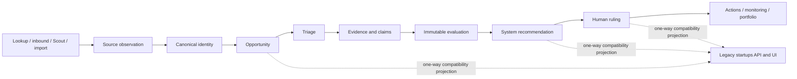

# Institutional Authority and Funnel Cutover Design

**Status:** Approved working design  
**Date:** 2026-07-20  
**Branch:** `codex/institutional-authority-cutover`

## 1. Decision

Aethria will move from the legacy `startups` aggregate and persona pipeline to a
canonical, evidence-centred opportunity lifecycle. The migration will use a
reversible, per-tenant strangler cutover:

1. Canonical records become the sole write authority for activated tenants.
2. The existing `startups` API and UI remain available through a one-way,
   idempotent compatibility projection.
3. Historical data is backfilled and reconciled before canonical reads are
   activated.
4. Every company receives identity resolution and triage, while expensive
   evidence work and additional reviews are conditional.
5. Scout, Reviewer, Partner, and Meta become replaceable workers. None owns
   durable truth or a human investment decision.

The selected rollout is preferred over long-lived dual writes, which preserve
split authority, and over a hard cutover, which combines data, backend, and
frontend risk into one release.

## 2. Problem

The institutional foundation already contains strong tenant-scoped identity,
evidence, evaluation, recommendation, ruling, job, monitoring, outcome, and
fund-intelligence repositories. The production lifecycle nevertheless remains
centred on the legacy `startups` row:

- durable jobs invoke the legacy Scout -> Reviewer -> Partner pipeline;
- evidence and claims are not populated by normal acquisition flows;
- canonical evaluation is an isolated explicit endpoint;
- canonical human rulings do not drive the legacy deal state or portfolio;
- memo, queue, portfolio, and most frontend reads use nested legacy JSON;
- legacy and canonical recommendation vocabularies disagree;
- the universal three-persona review creates correlated cost and false
  precision rather than independent diligence;
- operational skips and partial failures can be recorded as successful jobs.

The result is a well-implemented institutional substrate running beside, rather
than underneath, the product.

## 3. Goals

1. Make `Company`, `SourceObservation`, and `Opportunity` the authoritative
   identity and lifecycle records.
2. Make artifacts, evidence items, claims, immutable evaluations,
   recommendations, and human rulings the authoritative decision record.
3. Keep the current product usable throughout migration.
4. Guarantee that only an explicit human `INVEST` ruling creates a portfolio
   position.
5. Give every company visible, versioned triage without running full diligence
   on every company.
6. Make recommendation outcomes reproducible from evidence, thesis, policy,
   and manifests.
7. Make budget, thesis, identity, provider, and policy failures explicit and
   recoverable rather than translating them into PASS or success.
8. Migrate all historical rows with exact accounting and no silent omission.
9. Convert MetaAgent into proposal-only Fund Intelligence with human
   publication.
10. Certify the cutover through authenticated, real-PostgreSQL end-to-end
    scenarios in addition to unit and contract tests.

## 4. Non-goals

- Replacing the CRM or sending unapproved external writes.
- Treating public-web evidence as a substitute for founder conversations.
- Automatically rejecting or hiding companies without an inspectable triage
  record.
- Importing legacy model scores as if they were new canonical evaluations.
- Allowing an LLM to make a final human ruling or mutate live policy.
- Completing monitoring, CRM export, confidential intake, imports, outcomes,
  and Fund Intelligence before the authoritative lookup-to-ruling slice works.

## 5. System invariants

These rules apply in every rollout mode:

1. Every read and write is scoped by explicit `user_id`.
2. A complete active thesis and published policy are hard gates for triage that
   claims mandate awareness, evaluation, and recommendation.
3. Identity ambiguity blocks downstream evaluation until explicitly resolved.
4. A failed or blocked workflow is never represented as PASS.
5. Missing criteria remain unscored; they are never filled from an overall
   score.
6. An authoritative scored claim requires traceable supporting evidence under
   the configured evidence standard.
7. Critical risks and hard mandate exclusions take precedence over score bands.
8. Recommendation and human ruling are different records with different
   vocabularies and owners.
9. `ADVANCE` means active diligence; it never means a position was created.
10. Only `HumanRuling.INVEST` may create a portfolio position.
11. Canonical writes and their outbox events commit in the same PostgreSQL
    transaction.
12. Projection consumers are idempotent, replayable, and never write back into
    canonical authority.
13. A worker that loses its lease cannot continue authoritatively or mark a job
    complete.
14. Every historical startup in a migration snapshot has exactly one terminal
    migration classification.
15. Meta and Fund Intelligence may propose changes but may not publish them.

## 6. Authority model



| Concern | Authoritative owner | Compatibility role |
|---|---|---|
| Identity | `Company`, identifiers, aliases, observations, identity cases | Legacy name/domain fields are projections |
| Lifecycle | `Opportunity` plus canonical workflow state | Legacy pipeline state is a projection |
| Evidence | Artifacts, items, claims, and claim links | Legacy sources and narratives are display-only projections |
| Evaluation | Immutable evaluation runs and criterion assessments | Legacy Reviewer JSON is a historical/display projection |
| Recommendation | Immutable recommendation | Legacy Partner JSON is a display projection |
| Fund decision | Append-only human ruling | `human_resolution` is a projection |
| Portfolio | Consumer of canonical `human_ruling.created` with `invest` | Legacy PortfolioEngine skips canonical opportunities |
| Memo | Canonical decision-view assembler | Markdown may be projected into `startups` during migration |
| Learning | Outcomes, corrections, attributed overrides, audits | Legacy aggregate metrics are non-authoritative inputs |

For activated tenants, legacy services may read projected fields but may not
overwrite canonical identity, evaluation, recommendation, or ruling state.

## 7. Rollout control

Add a tenant-scoped rollout record with the following modes:

```text
legacy -> shadow -> backfill -> canonical_write -> canonical_read
```

- `legacy`: current behavior remains authoritative.
- `shadow`: canonical work records comparison data but does not affect user
  outcomes or legacy projections.
- `backfill`: the tenant snapshot is being classified and reconciled; new
  traffic continues under the preceding safe mode.
- `canonical_write`: all new authoritative mutations enter canonical services;
  the existing product reads the compatibility projection.
- `canonical_read`: queue, memo, decision, monitoring, and portfolio read
  canonical APIs directly.

The rollout record stores `user_id`, mode, activation timestamps, activating
actor, snapshot/backfill reference, last reconciliation status, and version.
Mode transitions are validated and append an audit/outbox event. A global kill
switch may stop canonical workers or canonical frontend reads, but it may not
delete canonical records.

Rollback from `canonical_write` or `canonical_read` switches user traffic to
legacy reads/intake, pauses canonical workers, and preserves all append-only
records. Events created during the rollback window are reconciled before a
later promotion.

## 8. Canonical workflow and state separation

The current `opportunities.decision_state` mixes workflow and decision
concepts. Introduce canonical `workflow_state`; treat `decision_state` as a
temporary compatibility projection derived from the latest ruling and
lifecycle.

Canonical workflow states are:

```text
admitted
identity_review
triage_pending
triaged_light
deep_review_pending
evidence_active
evaluation_pending
ruling_pending
monitoring
completed
blocked
archived
```

Blocked workflows also store a typed `block_code`, detail, and recovery action.
Current recommendation is read through `current_recommendation_id`; current
human decision is read through `current_ruling_id`. No consumer infers a human
decision from a workflow state.

Valid high-level transitions are:

- observation admitted -> `admitted` or `identity_review`;
- resolved identity -> `triage_pending`;
- triage -> `triaged_light`, `deep_review_pending`, or `blocked`;
- evidence work -> `evidence_active` -> `evaluation_pending`;
- completed evaluation -> `ruling_pending`;
- human ADVANCE -> `deep_review_pending` with a diligence action;
- human MONITOR -> `monitoring` with a next-review schedule;
- human PASS -> `completed`;
- human INVEST -> `completed` plus one portfolio command;
- operator archival -> `archived`.

Every transition is tenant-scoped, conditional on the expected prior version,
and emits an outbox event.

## 9. Every-company triage

Add an immutable, versioned `TriageAssessment` for every resolved opportunity.
Triage is a routing decision, not an investment recommendation.

Inputs:

- identity confidence and verified reference availability;
- source channel, source quality, and novelty/duplication;
- explicit thesis hard constraints and exclusions;
- supported stage, sector, geography, and basic traction signals;
- missing policy-critical evidence;
- current tenant research budget and queue capacity;
- policy and thesis version identifiers.

Dispositions:

```text
deep_review
light_monitor
insufficient_evidence
out_of_mandate
archive_candidate
```

The record includes reasons, contributing evidence/observation IDs, missing
information, policy/thesis versions, priority, confidence capped by evidence,
and creation trigger. `out_of_mandate` and `archive_candidate` stay visible and
never silently delete a company. Low-priority cohorts are sampled for operator
audit so false negatives can be measured.

Escalation to deep review occurs when policy priority is met, a GP requests it,
a potentially decisive criterion is unscored, credible claims conflict, a high
outcome is confidence-capped, or monitoring detects a verified material
change.

## 10. Opportunity pipeline application service

Create one application-layer orchestrator, `OpportunityPipeline`, rather than
embedding cross-domain flow in repositories or the legacy `Startup` object.

Conceptual interface:

```python
class OpportunityPipeline:
    async def process(
        self,
        *,
        user_id: str,
        opportunity_id: str,
        trigger: PipelineTrigger,
        job_context: JobContext,
    ) -> PipelineExecutionResult: ...
```

The service coordinates existing repositories and focused workers:

1. Load rollout mode and validate tenant authority.
2. Enforce identity, thesis, policy, and budget gates.
3. Create or reuse a versioned triage assessment.
4. Stop with a typed completed/blocked result for non-deep dispositions.
5. Create a bounded evidence plan and reserve its budget.
6. Retrieve source artifacts through configured channel adapters.
7. Extract candidate evidence and claims with provenance.
8. Validate, persist, and link evidence and claims.
9. Run the immutable deterministic evaluation.
10. Generate a canonical decision-view/memo projection.
11. Emit projectable completion events and settle actual cost.

Repositories remain the sole owners of their transactions. The orchestrator
uses durable checkpoints only at idempotent boundaries and passes typed stage
outputs in memory; `startups` is never used as inter-stage transport.

Manual lookup without a complete thesis may still create an observation,
resolve identity, and create an opportunity. It stops before mandate-aware
triage/evaluation with `THESIS_REQUIRED`; it never runs thesis-blind and emits a
recommendation.

## 11. Evidence workflow

An evidence plan declares required gaps, search questions, maximum artifacts,
provider/query/token limits, and a reserved USD budget. Retrieval workers
return artifacts; extraction workers return schema-bound candidate items and
claims. Deterministic evidence standards decide whether each candidate is
persistable and score-eligible.

Requirements:

- every claim has an assertion class and confidence;
- score-bearing externally verified claims have source links satisfying the
  evidence standard;
- operator-asserted private evidence is attributed and kept distinct from
  public verification;
- model-inferred or unverified claims cannot independently establish a
  decisive criterion;
- contradictory evidence is retained and lowers confidence rather than being
  overwritten;
- claim correction is append-only/superseding and triggers re-evaluation;
- prompt-injection detection and restricted-source handling remain enforced;
- missing evidence remains explicit and generates bounded next actions.

The first vertical slice adapts verified sources already gathered by manual
lookup into artifacts, items, and claims. Autonomous, confidential, CRM, and
monitoring acquisition adapters follow after the slice is certified.

## 12. Evaluation and recommendation

The existing immutable evaluator is the kernel, with these mandatory changes:

1. A claim is score-eligible only when its evidence relationship and assertion
   class satisfy policy; a model-provided numeric value alone is insufficient.
2. Missing dimensions remain unscored and reduce coverage.
3. Hard exclusions and critical risks are applied before score bands.
4. Defensibility and every weighted policy dimension participate consistently
   in coverage, variance, and outcome logic.
5. Recommendation confidence is capped by evidence coverage, source quality,
   contradiction, and freshness.
6. Same evidence snapshot plus same thesis/policy/manifests yields the same
   result.

System recommendation vocabulary remains:

```text
advance | monitor | pass | insufficient_evidence
```

Human ruling vocabulary remains:

```text
advance | monitor | pass | invest
```

The UI displays both ADVANCE and INVEST and explains their distinction. Override
classification compares like-for-like outcomes. `invest` following an
`advance` recommendation is a lifecycle progression, not automatically a
model disagreement; an explicit override is required only when the ruling
conflicts with the applicable recommendation semantics.

An LLM may explain a recommendation, draft diligence questions, or summarize
change conditions. It may not alter a deterministic hard exclusion or select
an outcome outside the policy-permitted set.

## 13. Agent redesign

### 13.1 Scout -> acquisition strategy worker

Scout selects bounded source/channel strategies from thesis coverage gaps and
returns observations, identity hints, source URLs, acquisition hypotheses, and
cost. It does not create authoritative facts, score its discovery, or write a
decision-ready startup.

The current personas become optional acquisition strategies. Autonomous Scout
may be disabled for deal-rich funds without disabling inbound, referral,
event, CRM, import, or manual channels. Scout performance is measured by useful
novelty, thesis coverage, source quality, duplicate/ambiguity rate, and cost.

### 13.2 Reviewer -> evidence analyst

The default three-persona committee is removed. One primary evidence analyst
plans gaps, extracts typed evidence/claims, preserves citations, identifies
contradictions/freshness, and maps qualitative material to anchored labels.
Deterministic services validate grounding and calculate authoritative scores.

A second adversarial worker runs only for sparse high-upside cases,
contradictory credible evidence, critical-risk indicators, threshold-near
outcomes, or explicit GP requests. A third worker is a domain specialist for a
specific regulatory, technical, market, or founder question, not another
generic personality.

### 13.3 Partner -> deterministic RecommendationEngine

Partner consumes only the immutable evaluation, evidence-quality summary,
mandate conflicts, critical risks, permitted portfolio context, and active
policy. It returns a canonical recommendation and change conditions. Critical
risks and hard exclusions own the outcome before averages. Normal operation
does not require an LLM.

### 13.4 MetaAgent -> Fund Intelligence

Meta analyses attributed corrections, recommendation/ruling differences,
explicit override reasons, verified outcomes, audit samples, cost, latency,
coverage, and calibration. It writes immutable reports and proposals with the
affected layer, supporting sample, limitations, historical impact preview,
shadow comparison, and required human approval. It cannot call `.apply()` on
weights, thresholds, prompts, or policy.

A later financing round is an outcome observation, not retroactive proof that
an earlier recommendation was wrong. Human corrections and explicitly
attributed judgments receive the highest learning weight.

## 14. Human rulings, actions, portfolio, and memo

`DecisionRepository` remains the sole ruling writer. Extend ruling provenance
with origin (`operator`, `legacy_backfill`, or governed import) and optional
source reference. All rulings remain append-only.

Ruling effects:

- `advance`: workflow returns to deep review and produces bounded diligence
  actions;
- `monitor`: monitoring is activated and a next-review action is scheduled;
- `pass`: opportunity is completed but remains searchable and outcome-eligible;
- `invest`: exactly one idempotent portfolio command/position is created.

External actions remain drafts until explicit approval. CRM export, email, or
other external writes are never implied by a ruling.

Create an `OpportunityDecisionView` query/DTO for queue, memo, and frontend
consumers. A canonical memo assembler reads this DTO, not nested legacy JSON.
During migration, rendered memo markdown and compatible list fields are
projected into the linked startup row.

## 15. Compatibility projection

The migration treats `startups` as a one-way read projection. Add an idempotent
projection consumer with an event-receipt ledger keyed by tenant and outbox
event ID.

Projection behavior:

- identity and source summaries update display/search fields;
- evaluation/recommendation update legacy Reviewer/Partner display fields with
  an explicit compatibility reason and canonical IDs;
- a human ruling updates `human_resolution`;
- canonical memo completion updates projected markdown;
- projection never changes a canonical pointer;
- replaying an event produces the same row and does not duplicate activity;
- projection lag and failures are observable and repairable.

All recommendation/ruling mappings are centralized in one compatibility module.
`ADVANCE` may be rendered with the legacy INVEST visual label only while the
frontend remains legacy, and only if the legacy PortfolioEngine excludes every
canonically linked opportunity. `INSUFFICIENT_EVIDENCE` projects as a visible
human-review state, never PASS.

The legacy escalation endpoint delegates to canonical ruling creation for a
linked opportunity. Direct writes to `startups.human_resolution` are removed
for activated tenants.

## 16. Durable jobs and failure semantics

`PipelineExecutionResult` has explicit outcomes:

```text
completed
blocked
skipped
failed_retryable
failed_terminal
```

Every non-completed result includes a code and operator-safe explanation;
blocked results include a recovery action. Handlers translate these outcomes
into durable job transitions instead of treating a normal return as success.

Checkpoints identify idempotent stage outputs and are consulted on retry.
Heartbeat failure or rejected lease extension sets a cancellation/fencing
signal checked before each authoritative write. The final `succeed` operation
must return true; a rejected conditional update is treated as lease loss, not
success.

Required recovery cases:

- canonical commit before projection crash -> outbox replay repairs projection;
- partial evidence acquisition -> persisted artifacts/claims are reused;
- identity ambiguity -> resolution explicitly requeues the same opportunity;
- budget exhaustion -> blocked with required additional authorization;
- provider outage -> retryable failure without recommendation mutation;
- policy/thesis unavailable -> blocked without thesis-blind evaluation;
- duplicate worker -> one authoritative terminal result and idempotent outputs.

## 17. Cost control

Reserve one per-opportunity evidence envelope before retrieval or model work.
The reservation covers planned providers, queries, artifacts, model calls,
tokens, and maximum USD cost. Each stage records actual usage and settlement is
transactional/idempotent.

The standard path uses one primary evidence analyst. Adversarial and specialist
workers require a recorded trigger and remaining reservation. Weekly and daily
tenant limits are enforced at reservation time. Budget denial persists a
blocked workflow; it is not a low score, PASS, or silent skip.

## 18. Historical migration and reconciliation

Create a migration run containing the tenant, frozen source-ID snapshot,
expected row count, cursor, mode, actor, timestamps, and status. Each source ID
has one item record with one terminal classification:

```text
linked_opportunity | identity_case | quarantined_malformed
```

The migration is dry-run-first, bounded to safe batches, resumable by stable
cursor, and idempotent by `backfill:<startup_id>`. A malformed row is
quarantined with a code and does not terminate its batch. The source query
includes every fallback field used by conversion, including `display_name`.

Historical treatment:

- identity and references become a backfill observation;
- verifiable referenced documents may become imported artifacts;
- narrative/model content is stored as attributed `unverified` legacy import,
  not externally verified evidence;
- legacy Reviewer/Partner payloads remain immutable migration snapshots and do
  not become current canonical evaluations/recommendations;
- existing human resolutions become canonical rulings with
  `origin=legacy_backfill` and the source startup ID;
- the first new canonical recommendation requires a real evidence workflow and
  active published policy.

Promotion requires:

- every frozen source ID classified exactly once;
- zero duplicate verified identifiers;
- zero cross-tenant links;
- every resolved observation has exactly one opportunity;
- every linked startup has exactly one tenant-scoped opportunity projection;
- every imported human decision maps to the current canonical ruling;
- zero post-activation legacy-only rows;
- all open identity cases and quarantined rows explicitly reported.

The observed count of 211 rows is recorded from the live tenant snapshot at
execution time. It is not hardcoded in code or tests.

## 19. API and frontend migration

Add canonical list/detail projections without bypassing existing auth or
TanStack Query patterns:

- `GET /api/opportunities` for queue/list projections;
- `GET /api/opportunities/{id}/decision-view` for memo and ruling context;
- existing identity, evidence, evaluation, ruling, action, monitoring, outcome,
  and fund-intelligence endpoints remain tenant-scoped;
- explicit process/retry endpoints enqueue durable work rather than running
  expensive stages in the request process.

Frontend migration order:

1. identity and workflow state;
2. evidence and immutable evaluation;
3. recommendation and all four ruling choices;
4. canonical queue/memo/portfolio;
5. actions and monitoring;
6. imports, outcomes, and Fund Intelligence.

Canonical views render honest empty/blocked states rather than hiding missing
evidence or recommendations. The compatibility `/api/startups` endpoint remains
available until canonical-read certification and rollback rehearsal succeed.

## 20. Monitoring and remaining workflows

After the authoritative vertical slice is certified:

- a tenant-scoped scheduler claims due `next_review_at` opportunities;
- monitoring reserves budget and retrieves new artifacts;
- material-change comparison uses evidence/claim changes, not only hashes of
  unchanged rows;
- a material change triggers the same canonical evidence/evaluation path;
- CSV and CRM imports create observations and queue triage;
- confidential intake stores real restricted artifacts/items before claims;
- verified outcomes require supporting evidence artifact IDs;
- workflow actions have approval, execution, failure, and external-reference
  states;
- Fund Intelligence proposals compile and preview the exact patch they publish.

These workflows share the same authority, job, budget, projection, and audit
contracts. They do not introduce a second pipeline.

## 21. Observability

Record per tenant, channel, cohort, policy version, and rollout mode:

- admission, identity ambiguity, duplicate, and triage counts;
- evidence coverage, unsupported-claim rejections, contradictions, and
  freshness;
- recommendation distribution, confidence, and human override attribution;
- false-negative audit results and verified outcomes;
- stage latency, provider/model calls, tokens, reserved/actual cost;
- job terminal outcomes, lease loss, retry, block, and dead-letter counts;
- outbox/projection lag, replay, and reconciliation drift;
- shadow legacy/canonical recommendation differences.

Logs and API status responses expose codes and safe summaries without leaking
tenant evidence or secrets.

## 22. Testing and certification

Unit and contract tests cover pure mapping, transitions, policy, grounding,
idempotency, and error translation. PostgreSQL integration tests run migrations
and validate transactions, RLS/service-role assumptions, unique constraints,
immutability triggers, leasing, outbox, and projection receipts.

Authenticated black-box scenarios against real PostgreSQL must cover:

1. manual lookup -> identity -> evidence -> evaluation -> recommendation ->
   memo -> human ruling -> portfolio/monitor state;
2. ambiguous identity -> blocked job -> operator resolution -> same workflow
   requeued and completed;
3. hard critical risk with otherwise high scores -> no ADVANCE;
4. unsupported/low-confidence claims -> no high decisive score;
5. missing thesis/policy -> blocked and no recommendation;
6. budget denial -> recoverable block and no provider/model call;
7. crash after canonical commit -> outbox replay repairs exactly one projection;
8. lease loss and duplicate workers -> one terminal result;
9. backfill dry-run/apply interrupted mid-run -> exact resume and reconciliation;
10. same-name/different-domain separation and verified-domain convergence;
11. malformed legacy row -> quarantined without batch loss;
12. cross-tenant access and link attempts denied;
13. append-only evaluation, recommendation, ruling, and outcome mutations
    rejected;
14. policy proposal preview and approval without automatic publication;
15. monitoring material change -> evidence refresh -> new immutable evaluation;
16. import -> observation -> triage queue without disappearing rows.

The existing fixture golden sets remain contract tests. A separate labeled
executable evaluation set measures precision at the review cutoff, false
ADVANCE rate, evidence coverage, confidence calibration, recommendation/ruling
divergence, cost, and latency.

Shadow promotion requires:

- zero unexplained identity or decision divergence;
- zero unaccounted migration rows;
- zero unsupported decisive claims in the reviewed sample;
- zero critical-risk false ADVANCE cases;
- reviewed low-priority audit samples;
- cost and latency within the approved cohort envelope;
- target migration/readiness gates passing;
- explicit operator approval and a successful rollback rehearsal.

## 23. Implementation slices

The program is implemented as independently reviewable slices in this order:

1. **Decision safety:** grounding, critical-risk precedence, thesis/policy gates,
   and typed job outcomes.
2. **Authority control:** per-tenant rollout state, canonical workflow state,
   event receipts, and the compatibility projector.
3. **Manual lookup vertical slice:** canonical evidence acquisition,
   evaluation, recommendation, memo, ruling, and projection.
4. **Ruling/portfolio cutover:** legacy escalation delegation, canonical deal
   state, INVEST-only portfolio consumer, and frontend decision vocabulary.
5. **Historical migration:** snapshot ledger, robust backfill, imported rulings,
   reconciliation, and one-tenant activation.
6. **Triage and agent migration:** versioned triage, acquisition Scout, evidence
   Reviewer, deterministic Partner, and proposal-only Meta/Fund Intelligence.
7. **Canonical frontend reads:** opportunity queue/detail/memo/portfolio and
   removal of activated-tenant legacy authority.
8. **Remaining workflows:** monitoring, imports/CRM, confidential evidence,
   actions, outcomes, and policy-learning completion.
9. **Certification and rollout:** real-PostgreSQL E2E, labeled evaluation,
   shadow metrics, rollback rehearsal, and tenant-by-tenant promotion.

Each slice has a separate test-driven implementation plan. A later slice may
not bypass or create a parallel version of the authority contracts established
by an earlier slice.

## 24. Acceptance criteria

The program is complete only when:

1. Activated tenants have exactly one authoritative identity, evidence,
   recommendation, and ruling path.
2. New manual, autonomous, inbound, import, and monitoring traffic enters
   through observations and the canonical opportunity workflow.
3. Every company receives visible triage and only triggered cases receive
   deeper model work.
4. The legacy three-persona universal Reviewer and score-owning Partner are no
   longer authoritative.
5. Meta/Fund Intelligence cannot mutate live configuration without human
   publication.
6. Every historical migration snapshot is exactly reconciled.
7. Canonical rulings drive queue, memo, actions, monitoring, portfolio, and
   learning consistently.
8. The compatibility projection is replayable and removable after canonical
   read activation.
9. All certification scenarios and target readiness checks pass with current
   evidence.
10. Rollback has been rehearsed without losing canonical or legacy records.

